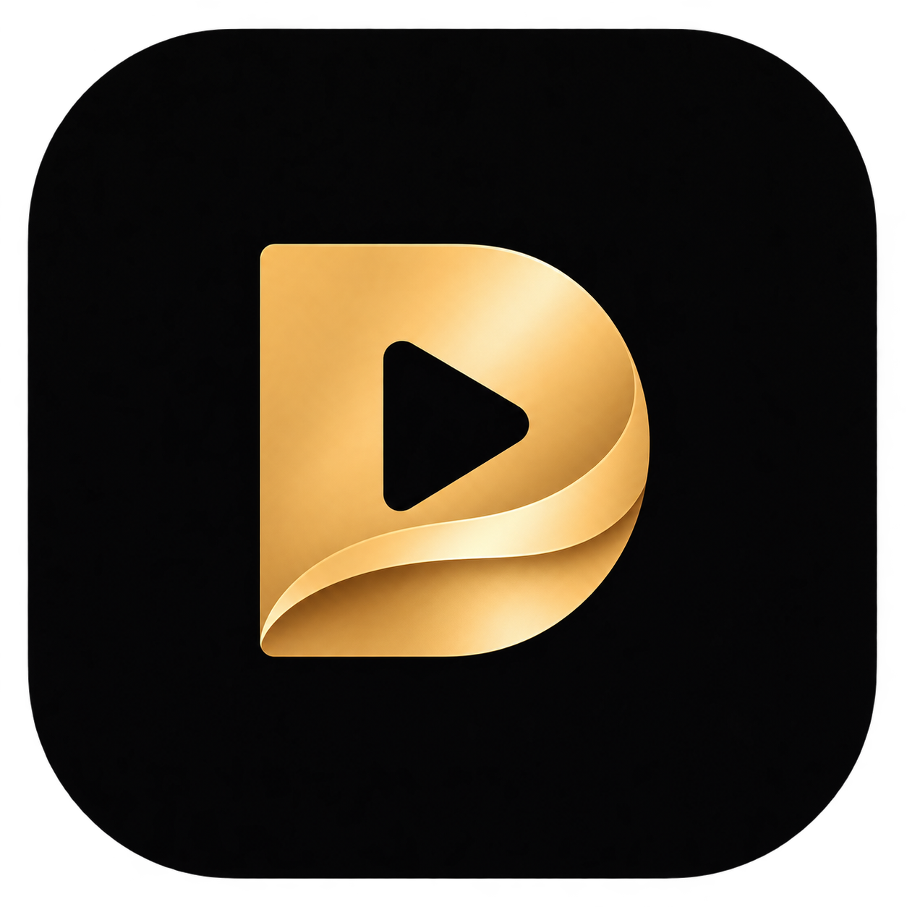

by 

# DeepStream Pro

[Deutsch](README.md) · English

**0.3 preview**

Our goal is high-fidelity sound for your own films and series — streamed locally or online on your Mac. DeepStream Pro plays your content from your Jellyfin server.

## Your cinema on Mac

DeepStream Pro runs on macOS; development and testing take place on Apple Silicon Macs.

## Your library at a glance

The app's own interface brings films and series together in a clear library. Film pages pair backdrop artwork with audio and video details, with audio tracks and Spatial Audio controls close at hand. Consistent navigation and back buttons make it easy to move around.

- **Spatial Audio on the film page:** Turn on spatial sound and use the macOS Fixed and Head Tracked modes with supported AirPods.
- **Dolby Atmos:** Enjoy Dolby Digital Plus with Dolby Atmos through Apple's audio playback.
- **The right audio track:** Automatic selection respects your language. You can also choose a track yourself at any time.
- **The details at a glance:** See the codec, language, channels, bitrate, sample rate and more audio and video information before playback.
- **Sound your way:** Playback starts with a neutral sound. Optional sound profiles let you adjust it to your taste.

Audio information identifies tracks including TrueHD, DTS:X, DTS-HD, Dolby Digital Plus, Dolby Digital and AAC.

## Coming in 0.4

Dolby Vision, HDR and opening local movie files are planned for 0.4.

## Downloads

There are currently no published downloads on the [releases page](https://github.com/DGi-Solutions/deepstream-pro/releases). The download will be a macOS installer signed with Developer ID and notarized by Apple.

## Building

The [build guide](dev/macos/README-deepstream.md) covers the required tools and dependencies (German).

## Contributing and license

Contributions and bug reports are welcome: [CONTRIBUTING.md](CONTRIBUTING.md). Please keep private media, credentials, profiles and unfiltered logs out of public issues and pull requests.

DeepStream Pro is a public fork of [Jellyfin Desktop](https://github.com/jellyfin/jellyfin-desktop), developed further by [DGi Solutions](https://dgi-solutions.de). We thank the Jellyfin Desktop contributors for their work. [Origin and upstream](docs/UPSTREAM.md) · [GNU GPL v2](LICENSE)
