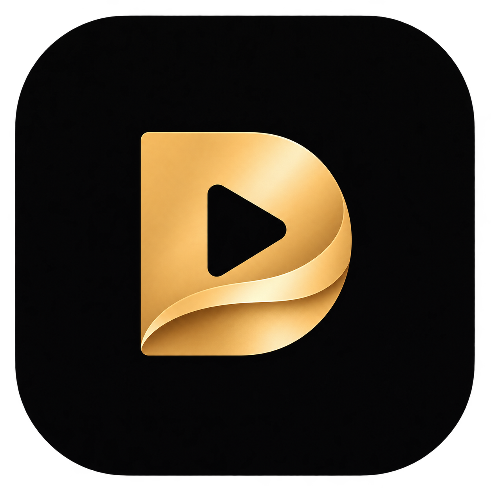

by 

# DeepStream Pro

**Ein audiophiler Filmplayer für macOS – entwickelt von [DGi Solutions](https://dgi-solutions.de).**

DeepStream Pro verbindet eine Jellyfin-Mediathek mit nativer Filmwiedergabe auf dem Mac. Unser Schwerpunkt ist Filmton: eine passende Ausgabe für das angeschlossene Gerät, möglichst wenig unnötige Signalverarbeitung und eine verständliche Anzeige des tatsächlichen Audiowegs.

Das Projekt ist ein eigenständig weiterentwickelter, öffentlicher Fork von [Jellyfin Desktop](https://github.com/jellyfin/jellyfin-desktop). Es befindet sich in aktiver Entwicklung.

## Plattform

**DeepStream Pro wird ausschließlich für macOS entwickelt.** Der aktuelle native Teststand ist für Apple Silicon mit macOS 27 gebaut. Weitere Mac-Konfigurationen werden erst nach entsprechender Prüfung als unterstützt aufgeführt.

## Aktueller Teststand

- Separate App **DeepStream Pro** mit eigenem Profil und eigener App-Identität.
- Native Videowiedergabe mit Qt WebEngine und libmpv.
- Experimentelle AVFoundation-Ausgabe für Apples räumliche Mehrkanalwiedergabe; Stereo bleibt verfügbar.
- Korrigierte Trailer-Ansteuerung und native Paketierung.
- Eigenes Erscheinungsbild in Schwarz und Gold, mit DGi Solutions als Absender.

In der lokalen Prüfung laufen Filmwiedergabe, Trailer und 7.1-PCM über AVFoundation. Das ist der derzeitige technische Stand, keine Aussage über vollständige Atmos- oder DTS:X-Objektwiedergabe.

## In Entwicklung: DeepStream Audio Engine

Unsere integrierte Audio-Engine soll Tonspuren und Ausgabegerät gemeinsam berücksichtigen:

- automatische Formatwahl innerhalb der gewünschten Sprache,
- Atmos und DTS:X, wenn der tatsächlich verfügbare Wiedergabeweg die räumlichen Informationen verarbeitet,
- passende Rückfälle für TrueHD, DTS-HD MA/HRA, Dolby Digital Plus (E-AC-3), Dolby Digital (AC-3), DTS, FLAC, ALAC, PCM und AAC,
- neutrale Wiedergabe sowie getrennte, bewusst gewählte Klangbearbeitung,
- Ausgabeprofile für Kopfhörer, integrierte Lautsprecher, USB-Audiogeräte und HDMI,
- verständliche Anzeige von Quelle, Verarbeitung und Ausgabe.

Diese Automatik und der native Objekt-Audio-Weg sind **Entwicklungsziele** und noch keine freigegebenen Produktfunktionen. Details: [Audio-Architektur](docs/AUDIO-ARCHITECTURE.md) und [Projektstatus](docs/STATUS.md).

## Downloads

Es gibt derzeit **keine stabile öffentliche Veröffentlichung**. Geprüfte macOS-Prüffassungen werden ausschließlich in den [Releases dieses Projekts](https://github.com/DGi-Solutions/deepstream-pro/releases) bereitgestellt, sobald sie veröffentlicht sind.

Quellcode-Archive von GitHub sind keine installierbaren Apps. Jede Prüffassung erhält eigene Angaben zu Version, Prüfsumme, getesteten Macs und Signaturstatus.

## Selbst bauen

Der native Build benötigt einen Apple-Silicon-Mac, macOS SDK 27 oder neuer, Qt 6.11.3 mit WebEngine sowie libmpv, CMake, Ninja und pkg-config. [Build-Anleitung](dev/macos/README-deepstream.md).

## Mitwirken

Fehlerberichte und Beiträge sind willkommen. Bitte beachte [CONTRIBUTING.md](CONTRIBUTING.md). Keine Filmdateien, Zugangsdaten, privaten Profile oder ungefilterten Diagnoselogs in öffentliche Issues oder Pull Requests laden.

## Herkunft und Lizenz

DeepStream Pro baut auf der Arbeit von Jellyfin Desktop und dessen Mitwirkenden auf. Herkunft, Basisstand und unsere Änderungen sind unter [UPSTREAM.md](docs/UPSTREAM.md) dokumentiert. Die vorhandene [GNU GPL v2](LICENSE) und weitere Komponentenhinweise bleiben erhalten.

**DeepStream Pro by DGi Solutions** · [dgi-solutions.de](https://dgi-solutions.de)
